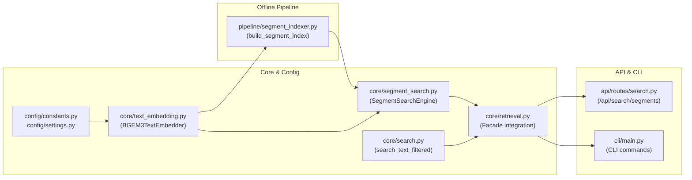

# Implementation Plan: Hierarchical Two-Stage Video Search (BGE-M3 + Filtered EVA-02)

**Status**: Ready for Implementation  
**Created**: 2026-08-15  
**Related Spec**: [`docs/specs/two-stage-hierarchical-search.md`](../specs/two-stage-hierarchical-search.md)

---

## 1. Goal Description
Nâng cấp hệ thống tìm kiếm AIC-26 với tính năng **Tìm kiếm 2 giai đoạn (Hierarchical Two-Stage Search)**:
1. **Stage 1 (Segment Retrieval)**: Sử dụng model `BAAI/bge-m3` (Dense 1024d) để tìm kiếm các phân đoạn video (segments) phù hợp từ kho dữ liệu mô tả video (`data/vid-description/*.json`), trích xuất danh sách candidate `video_id`s.
2. **Stage 2 (Filtered Keyframe Search)**: Cho phép thực hiện text search trên EVA-02 nhưng chỉ quét trong tập keyframes của các candidate videos được chọn từ Stage 1, tối ưu hóa tốc độ qua cơ chế cắt lát (slicing) mảng embedding trong RAM.

---

## 2. Core Architecture & Workflow



---

## 3. Tasks Breakdown

### Phase 1: Configuration & Model Wrapper
- [ ] **Task 1.1**: Update `src/aic26/config/constants.py` and `src/aic26/config/settings.py` (add `BGEM3_EMBEDDING_DIM = 1024`, `vid_description_dir`, `segment_index_path`, `bge_m3_model_name`).
- [ ] **Task 1.2**: Implement `src/aic26/core/text_embedding.py` (`BGEM3TextEmbedder` with batch embedding and query embedding, L2 normalization).
- [ ] **Task 1.3**: Add unit tests for `BGEM3TextEmbedder` in `tests/unit/test_text_embedding.py`.

### Phase 2: Segment Indexer & Stage 1 Search Engine
- [ ] **Task 2.1**: Implement `src/aic26/pipeline/segment_indexer.py` (`SegmentIndexBuilder` reading `data/vid-description/*.json`, building FAISS `IndexFlatIP(1024)` and saving `data/faiss_segment_index.pkl`).
- [ ] **Task 2.2**: Implement `src/aic26/core/segment_search.py` (`SegmentSearchEngine` with `search_segments(query, top_k)` returning segments & unique `candidate_video_ids`).
- [ ] **Task 2.3**: Add unit tests for segment indexing and search in `tests/unit/test_segment_search.py`.

### Phase 3: Stage 2 Filtered Keyframe Search (EVA-02)
- [ ] **Task 3.1**: In `src/aic26/core/embeddings.py`, build `video_to_indices: dict[str, list[int]]` in `EmbeddingIndex` for $O(1)$ video-to-keyframes lookup.
- [ ] **Task 3.2**: In `src/aic26/core/search.py`, add `search_text_filtered(query, video_ids, top_k)` using fast numpy array slicing & dot product.
- [ ] **Task 3.3**: In `src/aic26/core/retrieval.py`, wire `SegmentSearchEngine` and `search_text_filtered` to the `EVA02ImageRetrieval` public facade.
- [ ] **Task 3.4**: Add unit tests for filtered search in `tests/unit/test_filtered_search.py`.

### Phase 4: API Endpoints & CLI Commands
- [ ] **Task 4.1**: In `src/aic26/api/routes/search.py`, add endpoint `POST /api/search/segments` and support `video_ids` parameter in `POST /api/search/text`.
- [ ] **Task 4.2**: In `src/aic26/cli/main.py`, add `aic26 pipeline build-segment-index`, `aic26 search segments`, and `--videos` option to `aic26 search text`.
- [ ] **Task 4.3**: End-to-end integration testing and verification.

---

## 4. Verification Commands

```bash
# 1. Run unit tests
pytest tests/unit/test_text_embedding.py tests/unit/test_segment_search.py tests/unit/test_filtered_search.py -v

# 2. Build segment index
aic26 pipeline build-segment-index --input data/vid-description --output data/faiss_segment_index.pkl

# 3. CLI Stage 1 (Segment Search)
aic26 search segments -q "người sửa xe máy" -k 5

# 4. CLI Stage 2 (Filtered Keyframe Search)
aic26 search text -q "red motorcycle" --videos "L29_V001,L29_V005" -k 10
```
