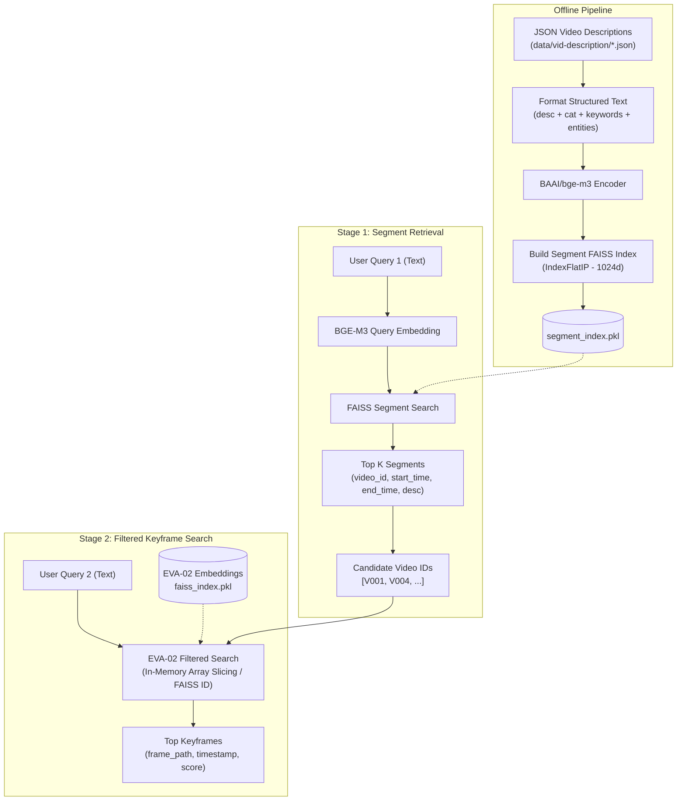

# Spec: Hierarchical Two-Stage Video Retrieval (BGE-M3 Segment Retrieval + Filtered EVA-02 Search)

**Status**: Draft v1  
**Date**: 2026-08-15  
**Owner**: AIC-26 team  
**Related modules**: `src/aic26/pipeline/extract_vid_description.py`, `src/aic26/core/embeddings.py`, `src/aic26/core/search.py`, `src/aic26/core/retrieval.py`

---

## 1. Objective & Overview

Hệ thống tìm kiếm video AIC-26 hiện tại quét trực tiếp trên toàn bộ keyframes qua EVA-02 CLIP embeddings. Đối với các truy vấn dài, giàu ngữ cảnh câu chuyện hoặc hành động diễn ra theo phân đoạn (segment), việc quét trên hàng trăm nghìn keyframes đơn lẻ dễ dẫn đến nhiễu (false positives) hoặc bỏ sót ngữ cảnh tổng thể.

**Mục tiêu của tính năng:**
Xây dựng luồng **Tìm kiếm 2 giai đoạn (Hierarchical Two-Stage Search)** tương tác theo 2 bước độc lập:

1. **Stage 1 (Segment Retrieval - BAAI/bge-m3)**:
   - Input: Text query mô tả sự kiện/bối cảnh (hỗ trợ đa ngôn ngữ Vi/En).
   - Model: `BAAI/bge-m3` (Dense embedding 1024 chiều, mạnh mẽ về ngữ nghĩa đa ngôn ngữ).
   - Search space: Các phân đoạn video được trích xuất sẵn từ `data/vid-description/*.json`.
   - Output: Top-$K$ segments phù hợp nhất kèm thông tin `video_id`, `start_time`, `end_time`, `description`, `score`, và trích xuất danh sách candidate `video_id`s duy nhất.

2. **Stage 2 (Filtered Keyframe Search - EVA-02 CLIP)**:
   - Input: Text query mới (hoặc tái sử dụng query Stage 1) + Danh sách candidate `video_id`s lấy từ Stage 1.
   - Model: `EVA-02 CLIP` (768 chiều).
   - Search space: **Chỉ quét trên toàn bộ keyframes của các candidate videos** đã lọc từ Stage 1 (thu hẹp search space từ 100% video xuống còn vài video mục tiêu).
   - Scope: Base Text Search thuần túy (không bật OCR scene text, không bật YOLO object detection / scene-graph overhead).
   - Output: Top keyframes chính xác trong các video được chọn.



---

## 2. Data Source & Embedding Pipeline (Stage 1)

### 2.1. Cấu trúc dữ liệu nguồn
Dữ liệu phân đoạn video được lưu trữ tại thư mục `data/vid-description/{video_id}.json` (sinh từ `extract_vid_description.py`).
Cấu trúc mẫu mỗi file JSON:

```json
{
  "video_id": "L29_V001",
  "segments": [
    {
      "start_time": "00:01:15",
      "end_time": "00:03:40",
      "description": "Cảnh một người đàn ông mặc áo đỏ đang sửa xe máy bên đường.",
      "category": "sửa chữa phương tiện",
      "entities": ["người đàn ông", "áo đỏ", "xe máy", "lề đường"],
      "keywords": ["sửa xe", "xe máy", "áo đỏ"]
    }
  ]
}
```

### 2.2. Chiến lược ghép text có cấu trúc (Structured Text Prompting)
Để tận dụng tối đa các trường thông tin trong JSON cho model `BAAI/bge-m3`:
```python
def format_segment_text(segment: dict) -> str:
    desc = segment.get("description", "").strip()
    category = segment.get("category", "").strip()
    keywords = segment.get("keywords", [])
    entities = segment.get("entities", [])

    parts = [desc]
    if category:
        parts.append(f"Thể loại: {category}")
    if keywords:
        kw_str = ", ".join(keywords) if isinstance(keywords, list) else str(keywords)
        parts.append(f"Từ khóa: {kw_str}")
    if entities:
        ent_str = ", ".join(entities) if isinstance(entities, list) else str(entities)
        parts.append(f"Thực thể: {ent_str}")

    return " | ".join(filter(None, parts))
```

### 2.3. Cấu trúc Index File (`segment_index.pkl`)
File index lưu dưới dạng pickle chứa:
```python
{
    "faiss_index": faiss.IndexFlatIP(1024),      # Index cosine similarity (normalized vectors)
    "embeddings": np.ndarray,                    # (N, 1024) float32 (L2 normalized)
    "segments": [                                # List metadata tương ứng từng vector index
        {
            "segment_id": 0,
            "video_id": "L29_V001",
            "start_time": "00:01:15",
            "end_time": "00:03:40",
            "description": "...",
            "category": "...",
            "entities": [...],
            "keywords": [...],
            "formatted_text": "..."
        },
        ...
    ],
    "video_to_segment_indices": {                # O(1) map video_id -> list of segment indices
        "L29_V001": [0, 1, 2],
        ...
    },
    "model_name": "BAAI/bge-m3",
    "embedding_dim": 1024
}
```

---

## 3. Architecture & Module Design

### 3.1. Danh mục các module cần tạo mới & chỉnh sửa

| Đường dẫn file | Vai trò / Trách nhiệm |
|---|---|
| `src/aic26/core/text_embedding.py` *(MỚI)* | Wrapper cho model `BAAI/bge-m3` (`BGEM3TextEmbedder`): Encode batch text segment và encode text query thành vector 1024d (L2 normalized). Quản lý thiết bị GPU/CPU. |
| `src/aic26/pipeline/segment_indexer.py` *(MỚI)* | Pipeline đọc `data/vid-description/`, ghép chuỗi text có cấu trúc, chạy batch embedding qua BGE-M3 và tạo `data/faiss/segment_index.pkl`. |
| `src/aic26/core/segment_search.py` *(MỚI)* | Engine truy vấn Segment (Stage 1): Load `segment_index.pkl`, thực hiện `search_segments(query, top_k)` -> trả về danh sách segments và candidate `video_id`s. |
| `src/aic26/core/search.py` *(CHỈNH SỬA)* | Thêm method `search_text_filtered(query, video_ids, top_k)`: Lọc không gian embedding của EVA-02 chỉ trên tập `video_ids` được truyền vào, tính dot product siêu tốc. |
| `src/aic26/core/retrieval.py` *(CHỈNH SỬA)* | Tích hợp `segment_search` vào facade `EVA02ImageRetrieval`, bổ sung public methods `search_segments(...)` và `search_text_filtered(...)`. |
| `src/aic26/api/routes/search.py` *(CHỈNH SỬA)* | Thêm endpoint `POST /api/search/segments` (Stage 1) và hỗ trợ field `video_ids` trong `POST /api/search/text` (Stage 2). |
| `src/aic26/cli/main.py` *(CHỈNH SỬA)* | Thêm command `aic26 pipeline build-segment-index` và `aic26 search segments`. |
| `src/aic26/config/settings.py` + `constants.py` | Thêm các config `BGE_M3_MODEL_NAME`, `SEGMENT_INDEX_PATH`, `VID_DESCRIPTION_DIR`. |

---

## 4. Detailed Component Specifications

### 4.1. `BGEM3TextEmbedder` (`src/aic26/core/text_embedding.py`)
Sử dụng `sentence-transformers` hoặc `transformers` + PyTorch để load `BAAI/bge-m3`:

```python
class BGEM3TextEmbedder:
    def __init__(self, model_name: str = "BAAI/bge-m3", device: Optional[str] = None):
        self.device = device or ("cuda" if torch.cuda.is_available() else "cpu")
        self.tokenizer = AutoTokenizer.from_pretrained(model_name)
        self.model = AutoModel.from_pretrained(model_name).to(self.device).eval()

    def embed_texts(self, texts: List[str], batch_size: int = 32, max_length: int = 8192) -> np.ndarray:
        """Sinh dense embeddings 1024d từ danh sách text (L2-normalized)."""
        ...

    def embed_query(self, query: str) -> np.ndarray:
        """Sinh dense embedding 1024d cho 1 query duy nhất."""
        ...
```

### 4.2. `SegmentSearchEngine` (`src/aic26/core/segment_search.py`)
Thực thi truy vấn Stage 1:

```python
class SegmentSearchEngine:
    def __init__(self, segment_index_path: str, embedder: BGEM3TextEmbedder):
        self.segment_index_path = segment_index_path
        self.embedder = embedder
        self._load_index()

    def search(self, query: str, top_k: int = 20) -> Dict[str, Any]:
        """
        Input: Text query (Tiếng Việt / Tiếng Anh)
        Output:
        {
            "segments": [
                {
                    "video_id": "L29_V001",
                    "start_time": "00:01:15",
                    "end_time": "00:03:40",
                    "description": "...",
                    "category": "...",
                    "score": 0.842
                }, ...
            ],
            "candidate_video_ids": ["L29_V001", "L29_V004", ...]  # Unique video IDs preserving top ranking
        }
        """
```

### 4.3. Stage 2 Filtered Search Optimization (`src/aic26/core/search.py`)
Khi người dùng kích hoạt Stage 2 với danh sách `video_ids`:
1. **Pre-mapped Keyframe Indices**: Trong `EmbeddingIndex`, tạo sẵn dictionary `self.video_to_indices = defaultdict(list)` map từ `video_name` sang mảng các chỉ số `row_idx` trong `self.embeddings`.
2. **Fast Slice & Dot Product**:
   ```python
   # Lấy tất cả row indices của các video được chọn
   target_indices = []
   for vid in video_ids:
       if vid in self.index.video_to_indices:
           target_indices.extend(self.index.video_to_indices[vid])
   
   if not target_indices:
       return []

   target_indices = np.array(target_indices, dtype=np.int64)
   sub_embeddings = self.index.embeddings[target_indices] # shape: (M, 768)

   # Dot product với query vector EVA-02 đã normalize
   scores = np.dot(sub_embeddings, query_vec.T).squeeze()
   
   # Lấy top-k nhanh bằng argpartition
   if len(scores) > top_k:
       top_sub_idx = np.argpartition(scores, -top_k)[-top_k:]
       top_sub_idx = top_sub_idx[np.argsort(-scores[top_sub_idx])]
   else:
       top_sub_idx = np.argsort(-scores)

   final_indices = target_indices[top_sub_idx]
   final_scores = scores[top_sub_idx]
   ```
3. **Hiệu năng**: Thay vì quét trên toàn bộ 500,000 keyframes, hệ thống chỉ quét trên ~1,000 - 5,000 keyframes của 5-10 video ứng viên -> Thời gian phản hồi < 5ms.

---

## 5. API & CLI Interface Specifications

### 5.1. REST API

#### Endpoint 1: Stage 1 - Segment Search
- **Route**: `POST /api/search/segments`
- **Request Body**:
  ```json
  {
    "query": "cảnh cứu hộ xe bị tai nạn trên đường cao tốc",
    "top_k": 20
  }
  ```
- **Response Body**:
  ```json
  {
    "status": "success",
    "query": "cảnh cứu hộ xe bị tai nạn trên đường cao tốc",
    "total_segments": 20,
    "candidate_video_ids": ["L29_V012", "L29_V003", "L29_V045"],
    "results": [
      {
        "video_id": "L29_V012",
        "start_time": "00:02:10",
        "end_time": "00:04:30",
        "score": 0.875,
        "description": "Xe cứu hộ đang kéo ô tô con màu trắng bị hỏng...",
        "category": "tai nạn giao thông",
        "keywords": ["cứu hộ", "xe tai nạn", "cao tốc"]
      }
    ]
  }
  ```

#### Endpoint 2: Stage 2 - Filtered Keyframe Text Search
- **Route**: `POST /api/search/text` (hoặc `POST /api/search/text-filtered`)
- **Request Body**:
  ```json
  {
    "query": "white car being towed",
    "video_ids": ["L29_V012", "L29_V003"],
    "top_k": 50
  }
  ```
- **Response Body**:
  ```json
  {
    "status": "success",
    "query": "white car being towed",
    "filtered_by_videos": ["L29_V012", "L29_V003"],
    "results": [
      {
        "video": "L29_V012",
        "frame_idx": 1420,
        "image_path": "data/keyframes/L29_V012/1420.jpg",
        "time": "00:02:50",
        "score": 0.812
      }
    ]
  }
  ```

### 5.2. CLI Commands
```bash
# 1. Build FAISS index cho video segments từ video descriptions
aic26 pipeline build-segment-index \
    --input data/vid-description \
    --output data/faiss/segment_index.pkl \
    --batch-size 64

# 2. Test Stage 1: Segment search qua CLI
aic26 search segments -q "người đàn ông sửa xe máy" -k 10

# 3. Test Stage 2: Filtered text search qua CLI
aic26 search text -q "man fixing motorcycle" --videos "L29_V001,L29_V005" -k 20
```

---

## 6. Verification & Test Plan

1. **Unit Tests**:
   - `tests/unit/test_text_embedding.py`: Test load model `BGEM3TextEmbedder`, test embedding dimension = 1024, test normalization.
   - `tests/unit/test_segment_search.py`: Test build mock segment index, search query, check candidate video deduplication logic.
   - `tests/unit/test_filtered_search.py`: Test `search_text_filtered` on subset of `video_ids` ensuring no keyframe outside candidate list is returned.
2. **Integration Tests**:
   - Chạy pipeline `build-segment-index` trên 2 file JSON mẫu trong `data/vid-description/`.
   - Gửi request Stage 1 qua REST API, lấy danh sách `candidate_video_ids`, sau đó gửi request Stage 2 kèm `video_ids` đó để verify keyframe trả về chính xác.
3. **Performance Target**:
   - Stage 1 Query latency: < 50ms trên GPU (BGE-M3 embedding + FAISS search).
   - Stage 2 Sliced Search latency: < 10ms trên CPU / GPU.
